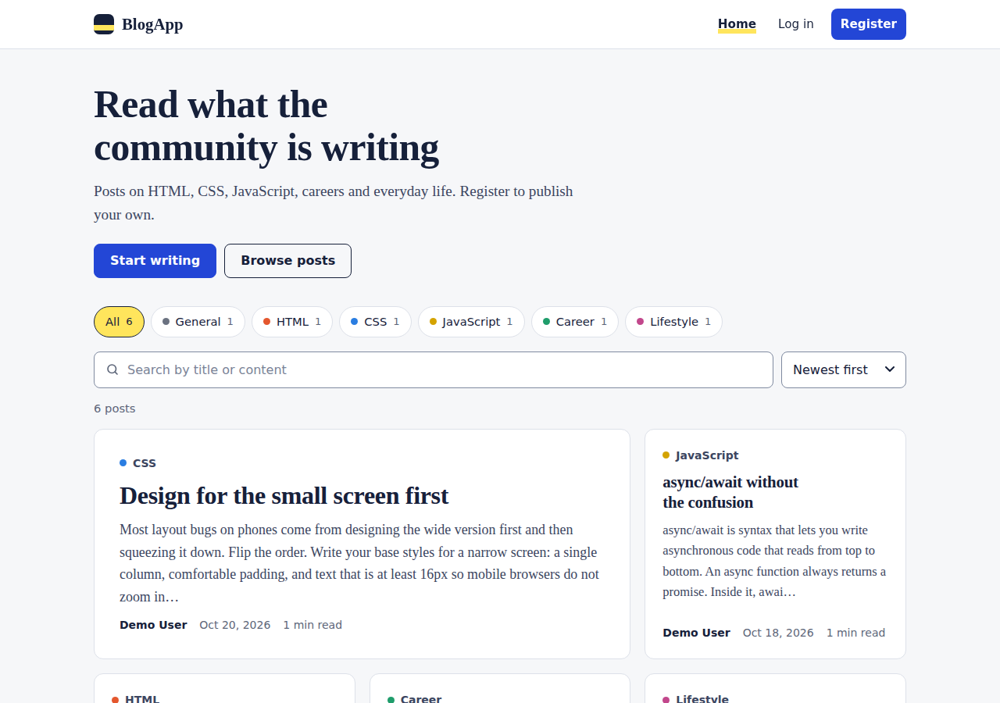
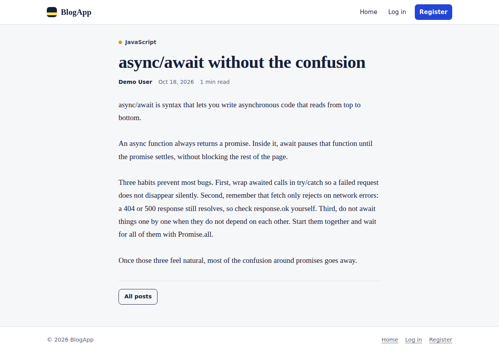
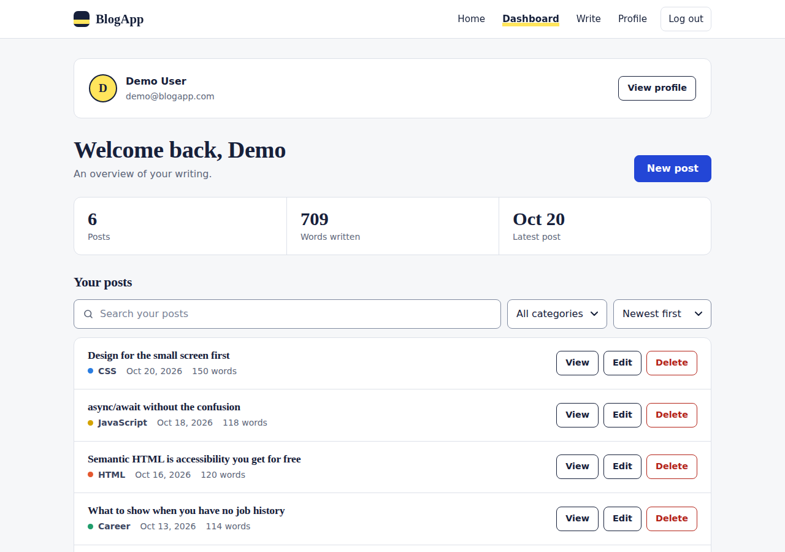
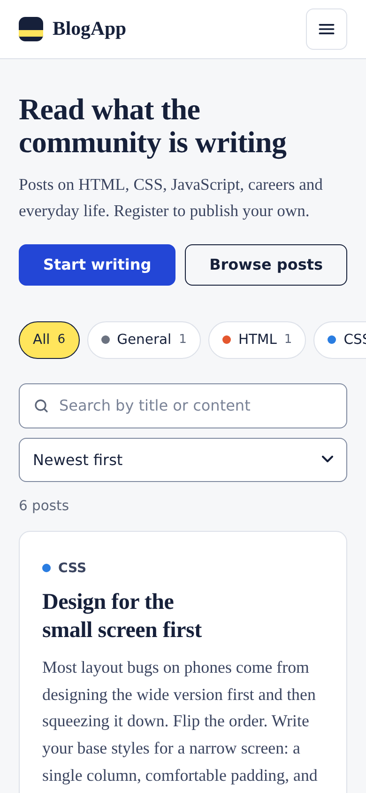

# BlogApp

A full-stack blogging platform. Readers can browse, search and filter posts; registered writers get a private dashboard to create, edit and delete their own posts and manage their account. Built with **Node.js, Express and MongoDB**, with a lightweight, accessible, mobile-first frontend in plain HTML, CSS and JavaScript (no build step).

**Live demo:** _add your Render URL here after deploying (see [Deployment](#deployment))_

| Home | Post |
|---|---|
|  |  |

| Dashboard | Mobile |
|---|---|
|  |  |

## Features

**Reading**
- Home feed with a featured lead post, category chips with counts, live search (title and content, with highlighted matches), sorting and pagination
- Shareable URLs for every filter (`/?category=CSS&q=grid&page=2`)
- Distraction-free article page with reading time

**Writing**
- Create, edit and delete posts (owner-only, enforced on the server)
- Live word count and reading-time estimate, unsaved-changes warning, confirmation before every delete
- Personal dashboard with stats and search / filter / sort over your own posts

**Accounts and security**
- Register and log in with JWT stored in an **httpOnly, SameSite=Strict cookie** (never exposed to JavaScript)
- Profile page: edit name and bio, change password, sign out on all devices, delete account
- Password policy, bcrypt hashing, rate limiting, CSRF same-origin check, NoSQL-injection guard, Helmet security headers

**Quality**
- Responsive from 320px phones to desktop; touch targets of 40px or more; form fields of 16px or more (no iOS zoom)
- Keyboard accessible: skip link, visible focus rings, ARIA states, `prefers-reduced-motion` respected
- No external fonts, scripts or CDNs: fast, private, and works with a strict Content Security Policy

## Tech stack

| Layer | Technology |
|---|---|
| Server | Node.js 18+, Express 4 |
| Database | MongoDB with Mongoose 8 |
| Auth | `jsonwebtoken`, `bcryptjs`, `cookie-parser` |
| Hardening | `helmet`, `express-rate-limit` |
| Frontend | Vanilla JS (ES2020), semantic HTML, CSS custom properties |

## Getting started

**Prerequisites:** Node.js 18.14 or newer and a MongoDB database. The easiest options are a free [MongoDB Atlas](https://www.mongodb.com/atlas) cluster, or locally with Docker (`docker compose up -d`).

```bash
git clone <your-repo-url> blogapp
cd blogapp
npm install

cp .env.example .env        # then edit .env (see below)
npm run seed                # optional: demo account + 6 sample posts
npm run dev                 # http://localhost:5000
```

Generate a strong `JWT_SECRET` with:

```bash
node -e "console.log(require('crypto').randomBytes(48).toString('hex'))"
```

The seed script creates the account `demo@blogapp.com` / `demo1234`. It is safe to run repeatedly; existing posts are skipped.

### Environment variables

| Variable | Required | Default | Description |
|---|---|---|---|
| `MONGODB_URI` | yes | – | MongoDB connection string (local or Atlas) |
| `JWT_SECRET` | yes | – | Long random string (32+ characters). The server refuses to start in production with the placeholder |
| `NODE_ENV` | no | `development` | Set to `production` when deployed (enables `Secure` cookies and proxy trust) |
| `PORT` | no | `5000` | Port to listen on (hosting platforms set this for you) |
| `JWT_EXPIRES_DAYS` | no | `7` | Session lifetime in days |
| `DISABLE_RATE_LIMIT` | no | – | `true` disables rate limiting, **outside production only**, so tests can be re-run freely |

### Scripts

| Command | What it does |
|---|---|
| `npm start` | Start the server |
| `npm run dev` | Start with auto-restart on file changes |
| `npm run seed` | Add the demo user and sample posts |
| `npm run test:auth` | End-to-end API tests for auth, sessions, profile, CSRF check |
| `npm run test:crud` | End-to-end API tests for blog create / read / search / update / delete and ownership |

The test scripts talk to a running server. Start it first (add `DISABLE_RATE_LIMIT=true` to `.env` if you run them often), then run them in a second terminal. Every line should show ✔.

## Deployment

BlogApp is a long-running Express server that serves both the API and the frontend from one origin, which is what makes the secure same-site cookie authentication work. That makes **Render** (or any host that runs Node processes, such as Railway or Fly.io) the right fit. Vercel and Netlify are built for static sites and serverless functions, and running this app there would mean rewriting the server as functions.

The repository includes a ready-made Render blueprint, [`render.yaml`](render.yaml).

### 1. Create the database (MongoDB Atlas, free)

1. Create a free **M0** cluster at [cloud.mongodb.com](https://cloud.mongodb.com).
2. **Database Access** → add a database user with a password (use letters and digits; special characters must be URL-encoded in the connection string).
3. **Network Access** → add `0.0.0.0/0`. Render's free tier has no fixed outbound IP, so Atlas has to accept connections from anywhere; the database user and password still protect it.
4. **Connect → Drivers** → copy the connection string and add the database name:
   `mongodb+srv://<user>:<password>@<cluster>.mongodb.net/blogapp?retryWrites=true&w=majority`

### 2. Deploy to Render

1. Push this project to a GitHub repository (`.env` is git-ignored and must never be committed).
2. In Render choose **New → Blueprint**, connect the repository and confirm.
3. When prompted, paste your Atlas connection string as `MONGODB_URI`. `JWT_SECRET` is generated for you and `NODE_ENV=production` is already set.
4. Wait for the build to finish. Render checks `/api/health` before sending traffic.
5. Open your `https://<name>.onrender.com` URL and register an account.

_Prefer clicking through manually?_ Create a **Web Service** with build command `npm install --omit=dev`, start command `npm start`, health check path `/api/health`, and set the three environment variables above.

### 3. Optional: add sample content

Run the seed script from your own machine, pointing at the Atlas database:

```bash
MONGODB_URI="mongodb+srv://..." npm run seed
```

This creates the public demo login `demo@blogapp.com` / `demo1234`. Skip it, or change that password from the profile page, if you do not want a shared demo account on a public site.

### Good to know

- **Free-tier cold starts:** Render's free instances sleep after about 15 minutes without traffic, and the first request afterwards can take up to a minute. The home page shows a "server may be waking up" hint while it loads.
- **HTTPS is required in production:** cookies are marked `Secure`. Render provides HTTPS automatically.
- **Health check:** `GET /api/health` returns `200` while the database is connected and `503` otherwise.

## API reference

Base path: `/api`. Authentication is the `bb_token` cookie set at login (an `Authorization: Bearer <token>` header is also accepted for API tools).

| Method | Endpoint | Auth | Description |
|---|---|---|---|
| POST | `/auth/register` | – | Create an account and start a session |
| POST | `/auth/login` | – | Log in |
| POST | `/auth/logout` | – | Clear the session cookie |
| POST | `/auth/logout-all` | ✔ | Invalidate every session on every device |
| GET | `/auth/me` | ✔ | Current user and post count |
| PUT | `/auth/profile` | ✔ | `{ name, bio }` |
| PUT | `/auth/password` | ✔ | `{ currentPassword, newPassword }` |
| DELETE | `/auth/account` | ✔ | `{ password }`: deletes the user and their posts |
| GET | `/blogs` | – | `?search=&category=&sort=newest\|oldest\|title&page=&limit=` |
| GET | `/blogs/categories` | – | Categories with post counts |
| GET | `/blogs/:id` | – | One post |
| GET | `/blogs/mine` | ✔ | Only the logged-in user's posts |
| POST | `/blogs` | ✔ | `{ title, content, category }` |
| PUT | `/blogs/:id` | ✔ owner | Update a post (partial bodies allowed) |
| DELETE | `/blogs/:id` | ✔ owner | Delete a post |
| GET | `/health` | – | Liveness and database status |

Status codes: `200`/`201` success · `400` validation · `401` not logged in or session expired · `403` not the owner, or cross-origin request · `404` not found · `409` email already registered · `429` too many attempts.

## How authentication works

1. **Login:** the server checks the bcrypt hash, signs a JWT containing the user id and a token version, and sends it as an httpOnly cookie.
2. **Every request:** the browser attaches the cookie; the `auth` middleware verifies the signature, loads the user and compares the token version.
3. **Password change or "sign out everywhere":** the user's token version is incremented, so every previously issued token stops working immediately.
4. **Frontend:** private pages stay hidden until `GET /api/auth/me` confirms the session with the server. The small user object cached in `localStorage` is used only to draw the navigation bar, never as proof of being logged in.

Additional safeguards: 10 failed logins per 15 minutes per IP; same-origin check on all state-changing requests; inputs coerced to strings before queries; `?next=` redirects limited to local pages; 100 KB body limit; deleting an account removes its posts.

## Project structure

```
server.js              App setup: security headers, rate limits, routes, static files, 404, shutdown
config/db.js           Mongoose connection
models/                User.js, Blog.js
middleware/            auth.js (JWT cookie check), sameOrigin.js (CSRF defence)
routes/                auth.js (account, session, profile), blogs.js (CRUD, search, pagination)
utils/                 token.js (JWT + cookie helpers), password.js (password policy)
scripts/               seed.js, seed-data.js, auth-test.js, crud-test.js
public/                Frontend
  index.html, blog.html, login.html, register.html,
  dashboard.html, create-blog.html, profile.html, 404.html
  css/style.css        Design tokens and all styles
  js/api.js            fetch wrapper (the only code that talks to the API)
  js/app.js            Shared UI helpers and one init function per page
render.yaml            Render blueprint
docs/screenshots/      Images used in this README
```

## Troubleshooting

| Symptom | Likely cause and fix |
|---|---|
| `Could not connect to MongoDB` on start | Check `MONGODB_URI`; for Atlas, confirm the IP allow-list (Network Access) and that special characters in the password are URL-encoded |
| Server exits with a `JWT_SECRET` message | Set a real random secret; the placeholder is refused in production |
| Logged out immediately after login on a deployed site | The site must be served over HTTPS (cookies are `Secure` in production) and `NODE_ENV=production` must be set so the proxy is trusted |
| `Too many failed login attempts` while testing | Rate limiting is working. Wait 15 minutes, or set `DISABLE_RATE_LIMIT=true` in a **development** `.env` |
| First page load is very slow on Render | Free-tier cold start; subsequent requests are fast |
